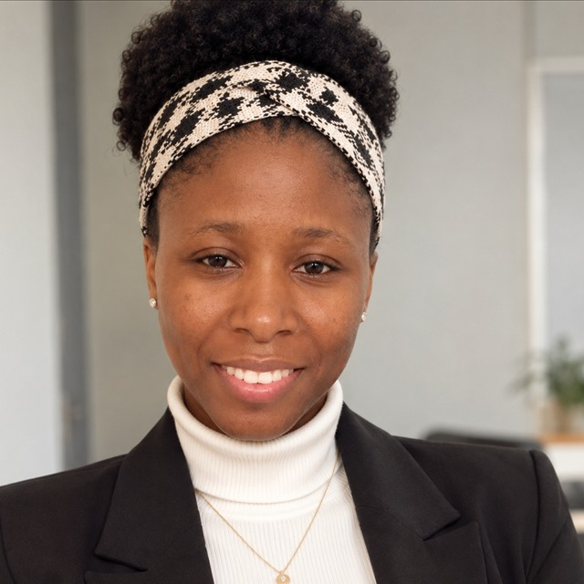

# Bonjour, je suis Matcheni Bamba 👋

Élève ingénieure en dernière année à l’ESTP Paris, spécialisée en **génie civil, topographie et géonumérique**. Je relie les relevés de terrain, les données spatiales et les outils numériques pour créer des cartes et des supports utiles aux projets.

🌐 [Portfolio](https://bamba2025-proj.github.io/WEBSIG/) · 💼 [LinkedIn](https://www.linkedin.com/in/bambamatcheni/) · ✉️ [Me contacter](mailto:matcheni.bamba@estp.fr)

## Ce que je fais

- **Topographie** : relevés, implantation, géoréférencement et traitement de données GPS
- **SIG et cartographie** : structuration de données spatiales, analyse et création de cartes
- **Automatisation** : scripts Python et bases de PyQGIS
- **Génie civil et VRD** : suivi de chantier, contrôle et production de plans
- **Cartographie web** : applications interactives et outils de collecte terrain

## Projets cartographiques

| Projet | Description | Technologies |
| --- | --- | --- |
| [Carte ferroviaire du Maroc](https://bamba2025-proj.github.io/WEBSIG/carte-presentation.html) | Carte du corridor Kénitra–Marrakech et collecte d’événements | Leaflet, GeoJSON |
| [Carte du réseau ferré français](https://bamba2025-proj.github.io/WEBSIG/carte-ferroviaire-france.html) | Recherche de villes et de lignes, filtres, mesures et formulaire de constat avec photo | Leaflet, GeoJSON, KML, CSV |

## Outils

**QGIS · ArcGIS Pro · Python · PyQGIS (bases) · AutoCAD · Covadis · Civil 3D · Revit · Leaflet**

## Formation

- **ESTP Paris** — Cycle ingénieur en génie civil, spécialité Topographie & Géonumérique · depuis 2023
- **INP-HB, Côte d’Ivoire** — Génie civil, option Géomètre · 2019–2022

📍 Cachan, Île-de-France · Français courant · Anglais intermédiaire